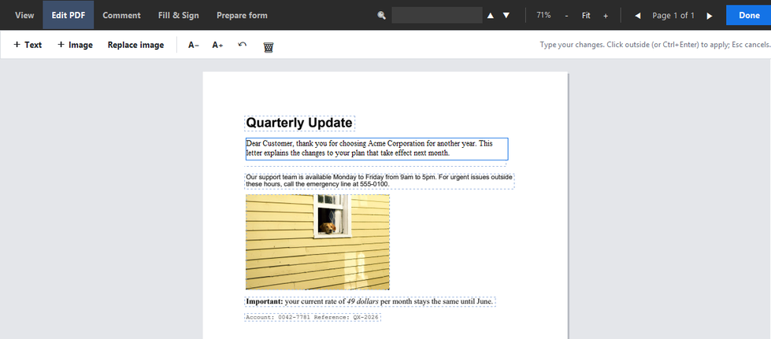

# PDF Toolkit

**Free, offline alternative to online PDF tools. No "2 free tasks a day", no uploads, no account.**


Merge, reorder, rotate, crop, delete and extract pages, split, compress, **edit the text and
pictures already in a PDF**, **read and search**, **comment and mark up**, **fill in forms and sign** (including **certificate signatures**), **create
fillable forms**, **compare two PDFs**, turn images into a PDF or pages into images, add page numbers,
headers and footers, Bates numbers or a watermark, and add or remove a password. Your documents never
leave your computer. Works on Windows and macOS.

## Download
Get the latest version from the [Releases page](https://github.com/collinb0607/pdf-toolkit/releases/latest).
Nothing else to install.

| Your computer | Download | First launch |
|---|---|---|
| Windows 10/11 | `PDF-Toolkit-Windows.exe` | Windows may show "Windows protected your PC" because the app isn't signed. Click **More info**, then **Run anyway**. The first start takes a few seconds. |
| Mac with Apple Silicon (M1 or newer) | `PDF-Toolkit-macOS.zip` | Unzip, then open **PDF Toolkit**. macOS blocks it the first time because the app isn't notarized: open **System Settings → Privacy & Security**, scroll down and click **Open Anyway**. |

On an Intel Mac, or any other system, run it from source with Python (below).

## How it works
Open files, then use the tabs at the top, as in big-name PDF editors: **Organize** (the page grid),
**View**, **Edit PDF**, **Comment**, **Fill & Sign**, **Prepare form** and **Compare**. Everything you do is added to
the PDF when you save; the **Tools** panel on the left sets what else happens when you save.

**Organize pages**
- **Add files**: drop PDFs, images or whole folders onto the window (they go where you drop them), or
  click **Add files** (they go after the selected page). Password-protected PDFs ask for the password.
- **Reorder**: drag pages. Select several with Ctrl+click or Shift+click and drag them together.
- **Rotate, duplicate, delete** from the toolbar, the right-click menu, or the keyboard (Delete,
  Ctrl+D). Ctrl+Z / Ctrl+Y undo and redo, as many steps back as you like.
- **Insert a blank page** after the selected one (the same size as it).
- **Crop**: set margins in millimetres, or **trim white margins automatically**. Nothing is deleted:
  the edges are just hidden, and **Remove crop** brings them back.
- **Page size** slider makes the thumbnails bigger or smaller; double-click a page to see it large.
- Big documents are fine: 800 pages open in a fraction of a second, and thumbnails are drawn as you
  scroll.

**View**: read pages large, zoom (or **Fit**), scroll from page to page. **Search** (Ctrl+F) finds
text in every page and highlights each match. Drag across text to select it; Ctrl+C copies it.
Double-clicking a page in the grid opens it here.

**Edit PDF**: change what's actually on the page, not a layer on top of it.



- **Click any text** to edit it in place, then click outside (or Ctrl+Enter) to apply; Esc cancels.
  The paragraph re-wraps to its own width, and a heading or single line can grow toward the margin.
  **A−**/**A+** change the size; deleting all the words removes the text.
- The new words use the **PDF's own font** when it already has every letter needed. If not, the
  **same font from your computer** is used (only the letters needed are embedded, and only if the
  font's license allows it), and otherwise the closest standard font (Helvetica, Times or Courier).
- The old text is really gone (search and copy find the new words), and everything else on the page
  stays exactly where it was. If the new text is longer than the old, the editor says so: it runs
  below the original space rather than pushing the rest of the page down.
- **Pictures**: click one to select it, drag to move it, drag its corner to resize it (keeping its
  shape), **Replace image** to swap it, Delete to remove it. **＋ Image** and **＋ Text** add new ones.
- Every change is one undo step (Ctrl+Z or ↶), and the original file is never changed until you save.
- Limits: a paragraph that mixes fonts (like a bold word in a sentence) comes out in one font; text
  on turned pages, rotated text and text inside embedded graphics can't be edited yet; scans are
  pictures, so their "text" can't be edited (run OCR software first).

**Comment**: **highlight**, **underline** or **strike through** text (drag across it), add **sticky
notes**, **text boxes**, **rectangles**, **ellipses**, **arrows** and **freehand drawing**, in five
colors. Click a comment to select it, drag to move it, A−/A+ to resize, Delete to remove;
double-click a note or text box to edit it. They're saved as standard PDF comments, so Acrobat,
Preview and web browsers show them, and can reply to or change them (or flatten them into the page).

**Prepare form**: turn any PDF into a fillable form. Pick **Text field**, **Checkbox**, **Dropdown**
or **Signature field** and drag a box on the page; name each field (and type a dropdown's options)
in the toolbar. Fill & Sign can fill them straight away, and they work in any PDF reader once saved.

**Fill & Sign**: the page opens large:
- **Form fields** (in fillable PDFs) are highlighted: type into them, tick boxes, pick options.
- **Type anywhere**, on any PDF, fillable or not: pick **Ab** and click where the text goes. **✓**, **✗**
  and **📅** (today's date) work the same way. Drag anything to move it; **A−**/**A+** resize it; Delete
  removes it; double-click text to change it.
- **Sign ▾** adds your signature or initials. Create them once by **typing** your name (shown in a
  handwriting font from your computer) or **drawing** with the mouse, touchpad or pen. They're
  remembered on this computer only (in a `.pdf-toolkit` folder in your user folder) until you choose
  **Forget my saved signature and initials**.
- When you save, the app asks whether to **flatten**: make everything part of the page, so it can't
  be changed or moved (best for a signed contract), or keep it editable (form fields stay fillable,
  and placed text and signatures stay movable in PDF editors). Tick **Flatten when saving** in the
  Tools panel to always flatten without asking.

**Certificate signatures**: **Sign ▾ → Sign with a certificate…**, then drag a box. Use your own
certificate file (.p12 / .pfx, from your employer, a government ID scheme or a certificate
authority), or create a self-signed one in the app (kept, password-protected, in the same
`.pdf-toolkit` folder). The signature is added as the very last step of saving, with a visible box
showing your handwritten signature (if you have one), name, date and reason. Anyone can then check
that the document hasn't changed since it was signed: changing even one character breaks it. A
self-signed certificate proves that, but PDF readers will say the signer's identity is unknown: a
certificate from an authority they trust is what proves who you are.

When you open a PDF that's already certificate-signed, the editor shows who signed it, when, and
whether it was changed since. Saving creates a new file, which can't keep the original's signature,
so the app asks first (the original file is never changed).

**Compare**: pick the original and the changed version. Each page shows side by side with red boxes
where it differs, and the list beside it shows the words removed and added. Pages added or removed
at the end are listed too.

**Save**
- **Save as PDF**: every page in the workspace, as one PDF. Saving over one of the files you opened
  is safe.
- **Save selected pages**: just the selected ones, as a new PDF.
- **Split into several PDFs**: one file per page, every N pages, starting at chosen pages (e.g.
  "4, 9"), or one file per original file.
- **Export pages as images**: PNG or JPG, at the resolution you choose (150 DPI for screens, 300 for
  printing).
- **Print**: builds the finished PDF and opens it in your PDF reader; print from there.
- **Document properties**: set the title, author, subject and keywords saved in the PDF.

**Tools panel**, applied to whatever you save:

| Tool | What it does |
|---|---|
| Compress | Re-compresses the photos and scans inside the PDF. **Light** keeps them full size (JPEG quality 85), **Balanced** shrinks them to 2000 pixels (quality 70), **Strong** to 1200 pixels (quality 50). Text and drawings are never touched, and an image is only replaced if the new one is smaller. A 9.4 MB scanned PDF became 4.5 MB, 1.1 MB or 0.3 MB. |
| Page numbers | "1", "Page 1", "Page 1 of 9" or "1 / 9", bottom center, bottom right or top right. Placed upright on every page, even rotated ones. |
| Watermark | Your text, large, faint and diagonal across every page (e.g. DRAFT, CONFIDENTIAL). |
| Header & footer | Your own text at the top and bottom of every page, left, centered or right. `{page}`, `{pages}`, `{date}`, `{file}` and `{bates}` are filled in, e.g. `{file} — page {page} of {pages}`. |
| Bates numbers | `{bates}` becomes a prefix and running number, e.g. ACME-000041, ACME-000042… (six digits). When splitting, the numbers continue from file to file. |
| Forms & signatures | **Flatten when saving**: always make filled-in fields, signatures and comments part of the page. |
| Protect | A password needed to open the saved file (AES-256). Leave it off to save without one: that's how you **remove** a password from a PDF you opened. |
| Images to PDF | Each added image becomes a page: the image's own size, or centered on A4 or Letter paper. JPEG photos go in unchanged (no quality loss); other images are stored losslessly, transparency included. |

Fillable form fields keep working after you rearrange pages. **Bookmarks** (the outline in a PDF
reader's sidebar) are kept, pointing at the right pages; ones whose page you deleted are dropped.
When you combine files, each file gets a bookmark with its name, holding its own bookmarks.

## Run from source (Python)
### Setup (one time)
1. Install **Python 3.8+** from https://python.org. On Windows, tick **"Add Python to PATH"** during install.
2. Run the app (see below). The first time, it asks to install **pikepdf** (edits PDFs, using qpdf),
   **pypdfium2** (draws pages, using Google's PDFium), **Pillow** and **pillow-heif** (images, including
   HEIC), **pyHanko** (certificate signatures), **fontTools** (uses your computer's fonts when editing
   text) and **tkinterdnd2** (drag and drop). Click **Yes**; it's about a 45 MB download.

### Run
```
python pdf_toolkit.py        # Windows
python3 pdf_toolkit.py       # macOS
```
You can also give it files: `python pdf_toolkit.py a.pdf b.pdf photo.jpg`. On Windows you can
double-click `pdf_toolkit.py`. If you have more than one Python installed, double-clicking can run a
different one from `python` in a terminal, so it may ask to install the components once more.

## Troubleshooting
- **Page numbers, headers, typed text or watermark show "?" for some characters:** they use the
  standard Helvetica font built into every PDF reader, which covers Western European letters only.
- **Edited text came out in a different font:** the PDF only contained the letters it originally
  used, and the font isn't installed on this computer (or its license forbids embedding), so the
  closest standard font was used. Installing the font and editing again uses it.
- **"Signer's identity is unknown" in Acrobat:** the signature was made with a self-signed
  certificate. The document is still protected against changes; to prove identity, use a certificate
  from an authority.
- **A highlight doesn't work on a scanned page:** scans are pictures of text, with no text to select.
  Use a rectangle or freehand drawing instead (or run the scan through OCR software first).
- **A form's fields don't appear in Fill & Sign:** some forms (XFA forms made with Adobe LiveCycle)
  aren't standard PDF fields. Use **Ab** to type on the page instead.
- **Compress made little difference:** the PDF is mostly text, or its images are already small or in
  formats that are left alone (black-and-white scans, CMYK print images).
- **"The PDF looks damaged":** try opening and re-saving it in another PDF reader first.
- **Something fails with no message:** errors are also written to `pdf_toolkit_errors.log` in your
  temp folder. On Windows, paste `%TEMP%\pdf_toolkit_errors.log` into File Explorer's address bar.
  On Mac, run `open $TMPDIR/pdf_toolkit_errors.log`.

## Credits
Built on [pikepdf](https://github.com/pikepdf/pikepdf) / [qpdf](https://github.com/qpdf/qpdf),
[pypdfium2](https://github.com/pypdfium2-team/pypdfium2) / [PDFium](https://pdfium.googlesource.com/pdfium/),
[pyHanko](https://github.com/MatthiasValvekens/pyHanko) (certificate signatures) and
[fontTools](https://github.com/fonttools/fonttools) (font subsetting), all under
permissive licenses (MPL-2.0, Apache-2.0, BSD, MIT).

## Support this project
This app is free, with no ads, accounts or limits. If it saved you time or a subscription, you can
support its development on Ko-fi:

[](https://ko-fi.com/collinbrooksdev)

## Part of the Offline Toolkit
Also by me: [GIF Maker](https://github.com/collinb0607/gif-maker),
[Video Compressor](https://github.com/collinb0607/video-compressor),
[Audio Converter](https://github.com/collinb0607/audio-converter),
[Image Converter](https://github.com/collinb0607/image-converter),
[Background Remover](https://github.com/collinb0607/background-remover) and
[Image Upscaler](https://github.com/collinb0607/image-upscaler): free, offline replacements for
websites that cap your file size, add a watermark, or want a subscription.
