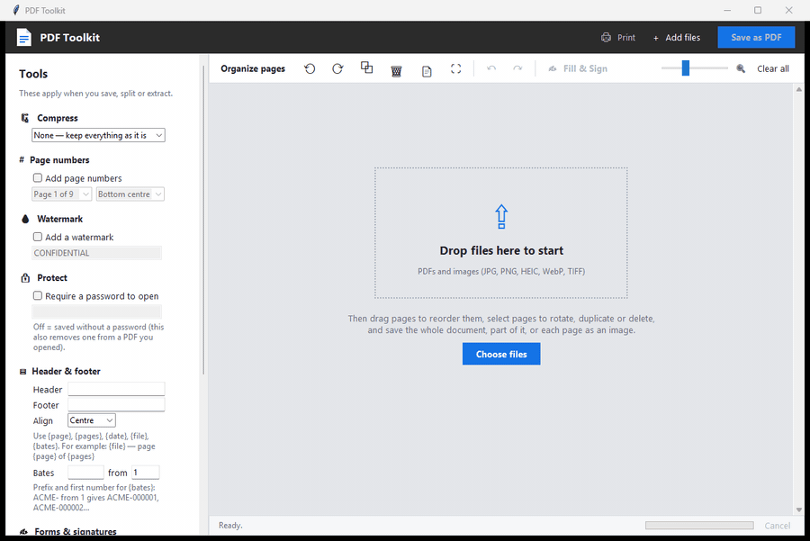

# PDF Toolkit

**Free, offline alternative to online PDF tools. No "2 free tasks a day", no uploads, no account.**



Merge, reorder, rotate, delete and extract pages, split, compress, turn images into a PDF or pages
into images, add page numbers or a watermark, and add or remove a password, all in one window that
shows every page as a thumbnail. Your documents never leave your computer. Works on Windows and macOS.

## Download
Get the latest version from the [Releases page](https://github.com/collinb0607/pdf-toolkit/releases/latest).
Nothing else to install.

| Your computer | Download | First launch |
|---|---|---|
| Windows 10/11 | `PDF-Toolkit-Windows.exe` | Windows may show "Windows protected your PC" because the app isn't signed. Click **More info**, then **Run anyway**. The first start takes a few seconds. |
| Mac with Apple Silicon (M1 or newer) | `PDF-Toolkit-macOS.zip` | Unzip, then open **PDF Toolkit**. macOS blocks it the first time because the app isn't notarized: open **System Settings → Privacy & Security**, scroll down and click **Open Anyway**. |

On an Intel Mac, or any other system, run it from source with Python (below).

## How it works
Open files, arrange the pages, save. The **Tools** panel on the left sets what happens when you save.

**Organize pages**
- **Add files**: drop PDFs, images or whole folders onto the window (they go where you drop them), or
  click **Add files** (they go after the selected page). Password-protected PDFs ask for the password.
- **Reorder**: drag pages. Select several with Ctrl+click or Shift+click and drag them together.
- **Rotate, duplicate, delete** from the toolbar, the right-click menu, or the keyboard (Delete,
  Ctrl+D). Ctrl+Z / Ctrl+Y undo and redo, as many steps back as you like.
- **Page size** slider makes the thumbnails bigger or smaller; double-click a page to see it large.
- Big documents are fine: 800 pages open in a fraction of a second, and thumbnails are drawn as you
  scroll.

**Save**
- **Save as PDF**: every page in the workspace, as one PDF. Saving over one of the files you opened
  is safe.
- **Save selected pages**: just the selected ones, as a new PDF.
- **Split into several PDFs**: one file per page, every N pages, starting at chosen pages (e.g.
  "4, 9"), or one file per original file.
- **Export pages as images**: PNG or JPG, at the resolution you choose (150 DPI for screens, 300 for
  printing).

**Tools panel**, applied to whatever you save:

| Tool | What it does |
|---|---|
| Compress | Re-compresses the photos and scans inside the PDF. **Light** keeps them full size (JPEG quality 85), **Balanced** shrinks them to 2000 pixels (quality 70), **Strong** to 1200 pixels (quality 50). Text and drawings are never touched, and an image is only replaced if the new one is smaller. A 9.4 MB scanned PDF became 4.5 MB, 1.1 MB or 0.3 MB. |
| Page numbers | "1", "Page 1", "Page 1 of 9" or "1 / 9", bottom centre, bottom right or top right. Placed upright on every page, even rotated ones. |
| Watermark | Your text, large, faint and diagonal across every page (e.g. DRAFT, CONFIDENTIAL). |
| Protect | A password needed to open the saved file (AES-256). Leave it off to save without one: that's how you **remove** a password from a PDF you opened. |
| Images to PDF | Each added image becomes a page: the image's own size, or centred on A4 or Letter paper. JPEG photos go in unchanged (no quality loss); other images are stored losslessly, transparency included. |

Fillable form fields keep working after you rearrange pages. Bookmarks (the outline in a PDF
reader's sidebar) and links between pages aren't carried over.

## Run from source (Python)
### Setup (one time)
1. Install **Python 3.8+** from https://python.org. On Windows, tick **"Add Python to PATH"** during install.
2. Run the app (see below). The first time, it asks to install **pikepdf** (edits PDFs, using qpdf),
   **pypdfium2** (draws pages, using Google's PDFium), **Pillow** and **pillow-heif** (images, including
   HEIC) and **tkinterdnd2** (drag and drop). Click **Yes**; it's about a 25 MB download.

### Run
```
python pdf_toolkit.py        # Windows
python3 pdf_toolkit.py       # macOS
```
You can also give it files: `python pdf_toolkit.py a.pdf b.pdf photo.jpg`. On Windows you can
double-click `pdf_toolkit.py`. If you have more than one Python installed, double-clicking can run a
different one from `python` in a terminal, so it may ask to install the components once more.

## Troubleshooting
- **Page numbers or watermark show "?" for some characters:** they use the standard Helvetica font
  built into every PDF reader, which covers Western European letters only.
- **Compress made little difference:** the PDF is mostly text, or its images are already small or in
  formats that are left alone (black-and-white scans, CMYK print images).
- **"The PDF looks damaged":** try opening and re-saving it in another PDF reader first.
- **Something fails with no message:** errors are also written to `pdf_toolkit_errors.log` in your
  temp folder. On Windows, paste `%TEMP%\pdf_toolkit_errors.log` into File Explorer's address bar.
  On Mac, run `open $TMPDIR/pdf_toolkit_errors.log`.

## Credits
Built on [pikepdf](https://github.com/pikepdf/pikepdf) / [qpdf](https://github.com/qpdf/qpdf) and
[pypdfium2](https://github.com/pypdfium2-team/pypdfium2) / [PDFium](https://pdfium.googlesource.com/pdfium/),
all under permissive licences (MPL-2.0, Apache-2.0, BSD).

## Part of the Offline Toolkit
Also by me: [GIF Maker](https://github.com/collinb0607/gif-maker),
[Video Compressor](https://github.com/collinb0607/video-compressor),
[Audio Converter](https://github.com/collinb0607/audio-converter),
[Image Converter](https://github.com/collinb0607/image-converter),
[Background Remover](https://github.com/collinb0607/background-remover) and
[Image Upscaler](https://github.com/collinb0607/image-upscaler): free, offline replacements for
websites that cap your file size, add a watermark, or want a subscription.
